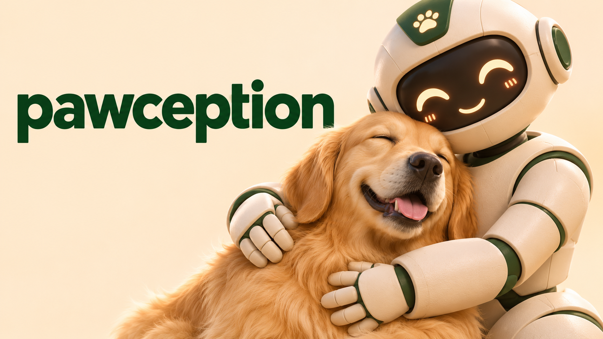

# Pawception



A watchful eye for your pet and your home.

Built for the Meta Global AI Developer Hackathon, Pawception combines personalized
pet monitoring, open-ended hazard detection, and insights from saved recordings.

[Three-minute demo](deliverables/demo-video/pawception-demo-3min.mp4) ·
[Prompts and schemas](prompts/README.md) ·
[Evaluation report](data/evaluations/submission-20261102T082730_792914Z/report.md) ·
[Reproduction guide](docs/reproduction.md) · [Third-party dependencies](docs/dependencies.md)

## The problem

Imagine heading out to run a few errands and leaving your pet home alone.
You wonder whether they are safe—and whether you would know if something
unexpected happened.

Every pet has different habits, and every owner has different concerns. One
owner wants to catch furniture chewing; another cares about repeated barking
or a pet getting somewhere it should not. Those concerns should be describable
in the owner's own words. But some of the most important situations are the
ones an owner never thought to specify: a kitten with its head trapped in a can,
an animal becoming stuck, or smoke spreading through the home.

Pawception addresses both needs: **personalized monitoring for events an owner
describes**, and **open-vocabulary hazard monitoring for visible risks across
pets, people, and the home**. It connects detections to video evidence, so an
owner can review what happened and its surrounding context. Saved recordings
also become a way to explore a pet's habits rather than watch hours of footage.

## What we implemented

Pawception is a single-camera web application with the same two modes shown in
the demo architecture: **Online mode** for near-live monitoring and **Offline
mode** for searching and understanding saved recordings. Online input can be a
webcam or a video replay that behaves like a live feed.

### Online mode

The flow is fixed video/audio windows → Muse Spark → temporal engine → alerts
and video evidence. The owner's descriptions are supported by two text features:

| Component | What it does |
| --- | --- |
| **Prompt Polish · Muse Spark** | Suggests three clearer, fuller descriptions of the same complete event. Selecting one returns to editing; the owner stays in control. |
| **Smart Routing · Muse Spark** | Auto selects Visual, Audio, or Visual + Audio. Audio-only tasks send sound only; checks using different models can run in parallel. |
| **Personalized events · Muse Spark** | Detects the described behavior and returns its intervals, evidence, representative timestamp, and visible target boxes. More events can be added while live. |
| **Safety Watch · Muse Spark** | Assesses visible, open-ended risks across the whole scene, including household dangers without a pet in view. Owners can toggle it, edit guidance, and add exclusions. |
| **Temporal engine** | Merges continuing detections across windows and applies duration rules. Overlap and tolerated gaps do not inflate detected time; continuing episodes retain one alert. |
| **Alerts + evidence** | Shows notifications, viewed/unviewed status, and matching video. The review timeline displays footage, processing status, event intervals, and alert markers together. |

The backend accumulates fixed windows and keeps a bounded queue when inference
falls behind. Failed or skipped windows add no detected activity. Live monitoring
does not run SAM; segmentation is used in saved-recording analysis.

### Offline mode

An owner can ask “Where does my pet spend the most time?” or search for something
specific in a saved recording. The three branches match the demo architecture:

| Component | Models and output |
| --- | --- |
| **Event search** | Muse Spark searches for multiple described events and returns timed matches linked to playback. Prompt Polish and Smart Routing also support these descriptions. |
| **2D hotspots** | SAM 3.1 locates the pet in sampled frames. Whole-mask occupancy produces a heatmap with estimated duration and percentage of visible time. Local change detection is an alternative for a single moving pet. |
| **3D hotspots** | Pet masks plus local MoGe fast depth produce an approximate background mesh and pet-center hotspots. Rotate the view, inspect time spent in a voxel, and open the contributing video moments. |

Sampling caps make long recordings manageable. Both 2D and 3D hotspots link
places back to source-video times. Here, “offline” means analysis of saved
footage: Muse event search and SAM still use the API; change detection and MoGe
run locally. The 3D geometry is approximate rather than a calibrated room scan.

## Run locally

Requires **uv 0.12.21** and **Python 3.12.14**. Both versions are pinned; no Node
build step, separate database service, or local GPU is needed for the base app.
The commands below use a macOS/Linux shell.

```sh
git clone https://github.com/jwkodes/pawception.git
cd pawception
# If needed, install the pinned uv version:
curl -LsSf https://astral.sh/uv/0.12.21/install.sh | sh
export PATH="$HOME/.local/bin:$PATH"
uv python install 3.12.14
uv sync --locked
uv run --locked python -m scripts.replay_ui --port 8765
```

Open **http://127.0.0.1:8765/monitor**. The six licensed short demo clips are
included as ordinary Git files; no footage download or Git LFS setup is needed.
The built-in kitten sample works from a fresh checkout.

**Try without an API key:** leave **Mock · No API calls** selected in Developer
settings and press **Go live**. Mock activities are scripted examples, independent
of the video contents; they test the interface and temporal pipeline.

**Use the real models:** copy the template and add your own Meta API key locally:

```sh
cp -n .env.example .env
```

Set `MODEL_API_KEY` in `.env`, then select **Muse · Real API calls** in the UI.
Requests go to `https://api.meta.ai/v1` and use your API credits. Opening the app
makes no inference calls. Prompt Polish, Smart Routing, and starting an analysis
are explicit actions that can make calls. `.env` is ignored by Git.

The `openai` Python package supplies a compatible client for Meta's endpoint;
it does not send these requests to OpenAI. Model availability and account
access are controlled by Meta.

### Live monitoring

Use the kitten sample, select another local video from
`data/demo/generated/online/`, or enable a webcam. Video replay behaves like a
live stream; the review timeline provides playback of captured footage.

Defaults: 60-second windows, 0-second overlap, 1-second event gap tolerance,
5-second custom-event alert thresholds, and Safety Watch enabled. Developer
settings expose model choices and reasoning effort. The standard demo settings
use Spark 1.3 Contributor for text/video and Spark 1.2 Contributor for audio.
Safety alerts trigger on supported detection rather than waiting for the custom
threshold. Continuing detections merge into one episode and alert; tolerated
gaps do not add detected time.

Webcam access is explicit; use a regular browser if the embedded browser cannot
record a camera.

### Saved recordings and hotspots

Open **http://127.0.0.1:8765/offline**. Choose a bundled clip or **Load a video**.
Event search supports several descriptions and the same Prompt Polish and
Smart Routing features as live monitoring. The long stationary-camera source is linked in
[demo media](docs/demo-media.md); it is not bundled.

For hotspots, use a stationary camera. Start with a short range and a small frame
cap in Developer settings, then increase it if needed. The cap defaults to 1,000
sampled frames; it does not imply inference on every source frame.

- **Change detection** runs locally with the base installation. It assumes one
  moving foreground subject; a resting pet can blend into the background.
- **SAM** uses the Meta API to locate the described pet and save sampled masks.
  Its progress and previews appear as results arrive.
- **3D hotspots** require the optional local MoGe setup below. They reuse a
  completed SAM or change-detection analysis and make no additional Meta calls.

### Optional MoGe setup for 3D

Keep its heavier dependencies in the separate environment expected by the app:

```sh
UV_PROJECT_ENVIRONMENT=.venv-moge uv sync --locked --group moge
uv run --locked python -m scripts.prepare_models moge
```

The download is pinned to a checkpoint revision and verified by size and SHA-256.
Then select a completed hotspot analysis, open **3D hotspots**, and click
**Build 3D map**. The worker chooses Apple MPS, CUDA, or CPU in that order; CPU
execution is slower. Native attention is used; CUDA/Triton is not required.
See [dependency details](docs/dependencies.md) for source revisions, licenses,
weight sizes, and the distinction between approximate and calibrated geometry.

## Prompts, media, and evaluation

[The prompt catalog](prompts/README.md) points to every runtime prompt builder,
readable exported prompts, and JSON schemas. Submitted prompts/responses are
saved with local runs.

[Demo media](docs/demo-media.md) lists bundled clips, licenses, source links,
and the long recording's timestamps. The finished narrated demo and source
credits are available as the [final MP4](deliverables/demo-video/pawception-demo-3min.mp4)
and [attribution file](deliverables/demo-video/ATTRIBUTION.txt).

The [evaluation report](data/evaluations/submission-20261102T082730_792914Z/report.md)
compares detections with human-reviewed intervals on eight development clips.
Mean positive temporal IoU is **0.832**. This is a revised development set,
not held-out evidence of general safety performance; exclusions and prompt
changes are documented. The report, annotations, scoring code, and comparison
charts are committed. The labeling UI is at `/label`.

The [reproduction guide](docs/reproduction.md) contains evaluation rerun
instructions and contributor checks. They are separate from app setup.

## Repository layout

| Path | Contents |
| --- | --- |
| `pawception/` | Application code, shared helpers, server, and analysis/evaluation implementations |
| `ui/` | Monitor, recording-analysis, labeling, and developer interfaces |
| `prompts/` | Prompt catalog, templates, and current exported examples |
| `scripts/` | Thin command entry points that call `pawception` implementations |
| `data/demo/` | Licensed short clips, manifests, hashes, and attribution |
| `data/ground_truth/` | Reviewed annotations |
| `data/evaluations/submission-20261102T082730_792914Z/` | Frozen development report and comparison charts |
| `deliverables/` | Finished demo video, thumbnail, and source credits |
| `docs/` | Reproduction instructions, dependency setup, and media references |

Downloaded weights, the long recording, raw experiment/session data, virtual
environments, and intermediate video exports stay local. No LFS is required for
the committed assets. The developer interface remains at `/`.
This is a hackathon prototype: model detections and estimated hotspots can be
wrong, and neither the evaluation nor the app constitutes a safety guarantee.
