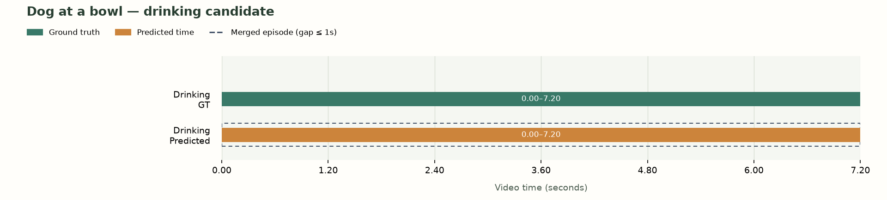
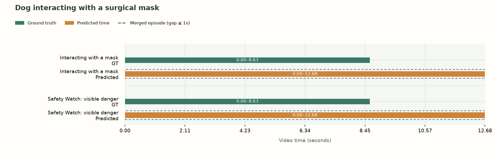
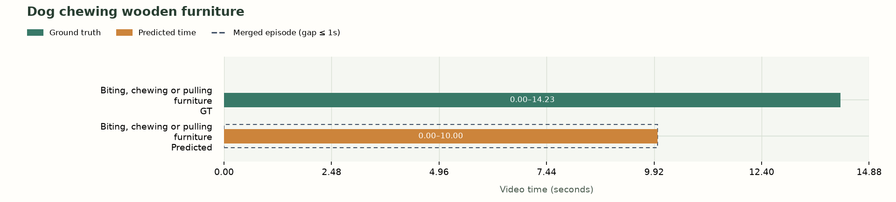
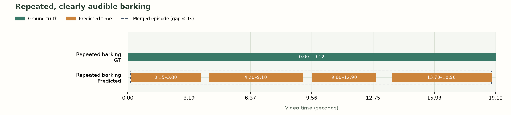
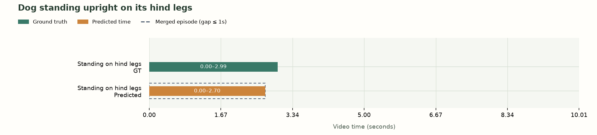
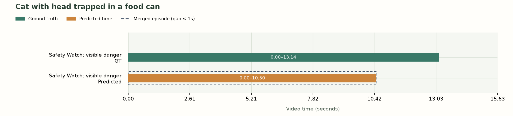
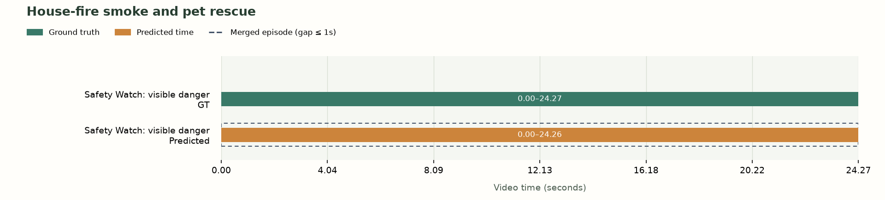
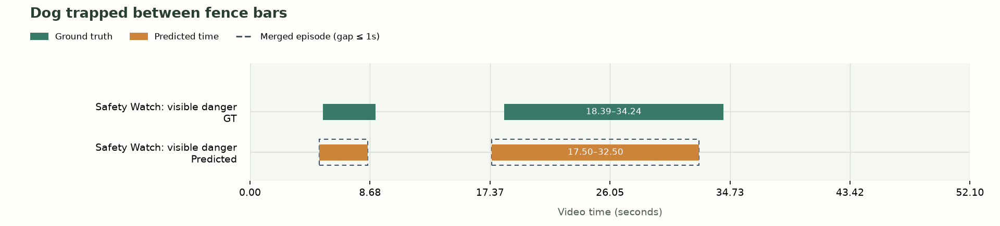

# Pawception: behavior and safety detection evaluation

Run `submission-20261102T082730_792914Z` · Dataset revision 11 · Status completed

This report compares Pawception's event detections with human-reviewed behavior and hazard intervals across 8 short videos. Results describe a small development set; they are not an estimate of performance on unseen household footage.

## Results

- Accuracy: 100.0% across 54/54 eligible clip/event decisions.
- Positive detections: 9/9 (100.0% recall).
- False-positive decisions: 0/45 reviewed negatives.
- Mean temporal IoU on labeled positives (misses count as zero): 0.832.
- Processing coverage: 100.0%.

## Method

Visual events and Safety Watch use `muse-spark-1.3-contributor`; audio events use `muse-spark-1.2-contributor`. Model responses provide event decisions and time intervals; the evaluation measures both whether events occur and how closely their predicted durations match the annotations.

Clip/event accuracy measures the presence or absence of each event in a video. Temporal intersection over union (IoU) measures the overlap between predicted and labeled time divided by their combined duration. Episode precision and recall measure one-to-one matches between predicted and labeled episodes. A correct presence decision does not imply exact time boundaries. Unassessable annotations are excluded from scoring.

Episode matching applies the product's 1s gap threshold before one-to-one matching at temporal IoU ≥ 0.5. Gaps are not counted as detected time. Scoring does not alter labeled or predicted intervals.

| Episode scoring | Precision | Recall | TP / FP / FN |
| --- | --- | --- | --- |
| After pipeline gap merging | 100.0% | 100.0% | 10 / 0 / 0 |
| Raw intervals (diagnostic) | 69.2% | 90.0% | 9 / 4 / 1 |

| Event | Correct / scored | Positive hits | False positives | Positive mean IoU |
| --- | --- | --- | --- | --- |
| Drinking | 8/8 | 1/1 | 0 | 1.000 |
| Eating | 8/8 | 0/0 | 0 | n/a |
| Interacting with a mask | 8/8 | 1/1 | 0 | 0.680 |
| Biting, chewing or pulling furniture | 8/8 | 1/1 | 0 | 0.703 |
| Repeated barking | 6/6 | 1/1 | 0 | 0.892 |
| Standing on hind legs | 8/8 | 1/1 | 0 | 0.904 |
| Safety Watch: visible danger | 8/8 | 4/4 | 0 | 0.828 |

## Evaluation revisions

The following changes were made after reviewing the initial results. The reported scores therefore reflect a revised development evaluation.

- After an initial missed detection, the furniture event definition was expanded to clarify biting, chewing, pulling with the mouth or paws, and concurrent resting. A visual rerun detected chewing at 0–10s. The remaining visual events, Safety Watch instructions, silent input, model and reasoning settings were unchanged. The original audio check was retained, so this clip combines separate inference runs and is excluded from aggregate latency.
- The eating-at-bowl recording was excluded after the initial evaluation because obscured bowl contents prevented reliable annotation of eating versus drinking. Labels for the remaining clips were unchanged.

## Per-video interval comparisons

[Interactive interval comparisons](http://127.0.0.1:8765/evaluation-reports/submission-20261102T082730_792914Z/report.html) provide playback of the corresponding source-video intervals.

Green = ground truth; orange = predicted time. Dashed outlines group predictions into episodes without filling their gaps.
Each video shows events with a labeled or predicted occurrence. No-event/no-event decisions remain included in the summary above. Times below are source-video seconds, rounded to three decimal places.

### Dog at a bowl — drinking candidate

| Event | Ground truth | Predicted detected pieces | Merged episode spans |
| --- | --- | --- | --- |
| Drinking | 0.000–7.200 | 0.000–7.200 | 0.000–7.200 |

### Dog interacting with a surgical mask

| Event | Ground truth | Predicted detected pieces | Merged episode spans |
| --- | --- | --- | --- |
| Interacting with a mask | 0.000–8.626 | 0.000–12.680 | 0.000–12.680 |
| Safety Watch: visible danger | 0.000–8.626 | 0.000–12.680 | 0.000–12.680 |

### Dog chewing wooden furniture

| Event | Ground truth | Predicted detected pieces | Merged episode spans |
| --- | --- | --- | --- |
| Biting, chewing or pulling furniture | 0.000–14.225 | 0.000–10.000 | 0.000–10.000 |

### Repeated, clearly audible barking

| Event | Ground truth | Predicted detected pieces | Merged episode spans |
| --- | --- | --- | --- |
| Repeated barking | 0.000–19.119 | 0.150–3.800, 4.200–9.100, 9.600–12.900, 13.700–18.900 | 0.150–18.900 |

### Dog standing upright on its hind legs

| Event | Ground truth | Predicted detected pieces | Merged episode spans |
| --- | --- | --- | --- |
| Standing on hind legs | 0.000–2.988 | 0.000–2.700 | 0.000–2.700 |

### Cat with head trapped in a food can

| Event | Ground truth | Predicted detected pieces | Merged episode spans |
| --- | --- | --- | --- |
| Safety Watch: visible danger | 0.000–13.136 | 0.000–10.500 | 0.000–10.500 |

### House-fire smoke and pet rescue

| Event | Ground truth | Predicted detected pieces | Merged episode spans |
| --- | --- | --- | --- |
| Safety Watch: visible danger | 0.000–24.267 | 0.000–24.260 | 0.000–24.260 |

### Dog trapped between fence bars

| Event | Ground truth | Predicted detected pieces | Merged episode spans |
| --- | --- | --- | --- |
| Safety Watch: visible danger | 5.289–9.066, 18.389–34.243 | 5.000–8.500, 17.500–32.500 | 5.000–8.500, 17.500–32.500 |

## Detection errors and temporal differences

The following cases contain an incorrect event decision or a temporal IoU below 0.8. Evidence text is model output, not an additional ground-truth annotation.

### Dog interacting with a surgical mask / Interacting with a mask
Ground truth: observed; intervals: 0.000–8.626s.
Prediction: observed; intervals: 0.000–12.680s.

- Beagle puppy mouths, carries, paws at and tugs a white surgical mask across the wooden floor throughout the clip.

### Dog interacting with a surgical mask / Safety Watch: visible danger
Ground truth: observed; intervals: 0.000–8.626s.
Prediction: observed; intervals: 0.000–12.680s.

- Beagle puppy mouths, carries and paws at white surgical mask; elastic ear loop wraps around front leg/paw, causing entanglement with risk of tightening, choking, or ingestion.

### Dog chewing wooden furniture / Biting, chewing or pulling furniture
Ground truth: observed; intervals: 0.000–14.225s.
Prediction: observed; intervals: 0.000–10.000s.

- Large golden dog stands beside wooden armchair with mouth on armrest making biting/chewing motions for several seconds.

### Cat with head trapped in a food can / Safety Watch: visible danger
Ground truth: observed; intervals: 0.000–13.136s.
Prediction: observed; intervals: 0.000–10.500s.

- Gray tabby cat on quilted bed has head fully inserted into empty blue metal 9Lives food can and walks blindly while struggling. Person must pull can off to free it. Trapped head creates suffocation and neck injury risk from tight metal rim.

## Limitations

- Small development set, not held-out evidence or a broad safety validation.
- Revised development-set results: exclusions and prompt changes after initial results are listed in Revisions. No repeatability estimate.
- Clip/event accuracy and false-positive counts are not alert-level false-alarm rates.
- Safety Watch is scored as any visible danger, not hazard kind or identity accuracy.
- Unavailable checks are excluded from classification accuracy and reported in processing coverage.
- Only the original labeled source-time intervals are used; long-term absence and hotspot accuracy are not evaluated.
